# Bộ 3 bài tập .NET — Thư viện · Phòng khám · Bàn bida

Ba chương trình WinForms minh hoạ **kiến trúc 3 lớp (GUI – BUS – DAL)** và **ADO.NET**
thuần (không dùng Entity Framework), mỗi bài có cơ sở dữ liệu riêng và **tự khởi tạo
cơ sở dữ liệu ngay khi chạy lần đầu**:

| Bài | Đề tài | Cơ sở dữ liệu | Chức năng chính |
|-----|--------|---------------|-----------------|
| 6.6 | Hệ thống quản lý mượn trả sách thư viện | `LibraryDB` | Độc giả, đầu sách, lập/trả phiếu mượn, cảnh báo quá hạn, thống kê |
| 6.7 | Hệ thống quản lý phòng khám & kê đơn thuốc | `ClinicDB` | Tiếp nhận bệnh nhân, hồ sơ khám, danh mục thuốc, kê đơn, thanh toán |
| 6.8 | Hệ thống quản lý bàn bida & dịch vụ giải trí | `BilliardsDB` | Sơ đồ bàn, gọi dịch vụ, tính giờ, thanh toán, doanh thu |

## Bài 6.6 — Hệ thống quản lý mượn trả sách thư viện

### Chức năng

| Tab | Nội dung |
|-----|----------|
| 1. Độc giả | Thêm/sửa/xoá độc giả, tìm theo tên, kiểm tra email hợp lệ và không trùng, hiển thị tình trạng thẻ |
| 2. Đầu sách | Quản lý danh mục sách, số lượng còn, tìm theo tên/thể loại |
| 3. Mượn / Trả | Lập phiếu mượn nhiều sách trong một phiếu (giỏ mượn tạm), lọc phiếu, trả sách |
| 4. Cảnh báo quá hạn | Danh sách phiếu quá hạn kèm số ngày quá hạn |
| 5. Thống kê | Số lượt mượn theo thể loại, tổng lượt mượn |

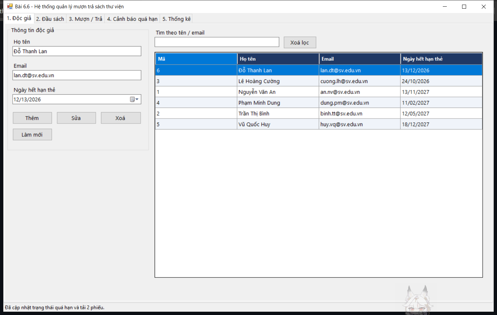
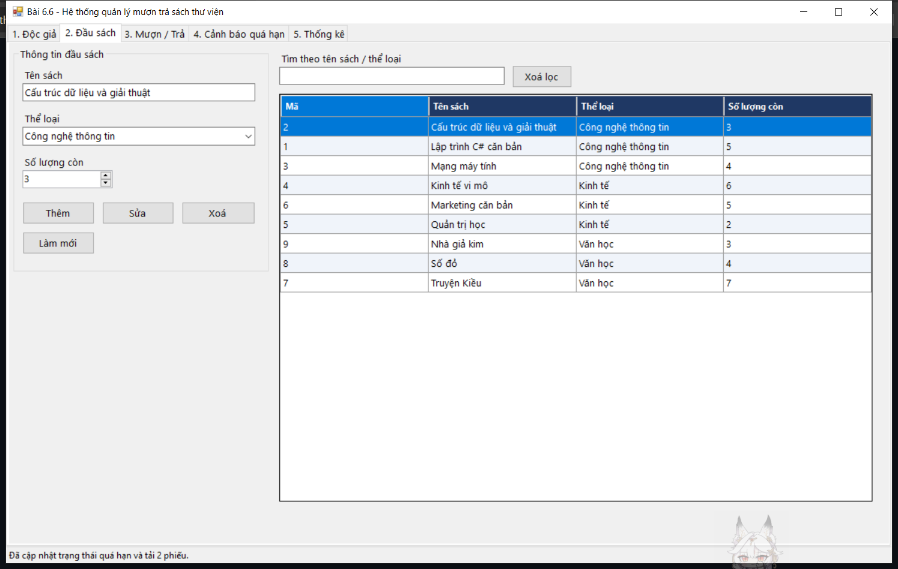
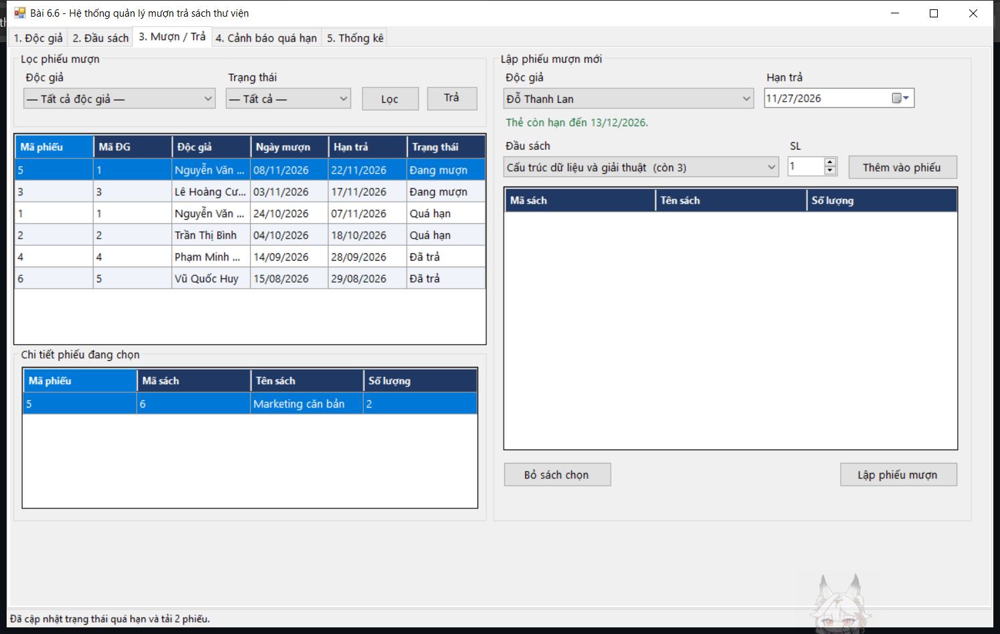
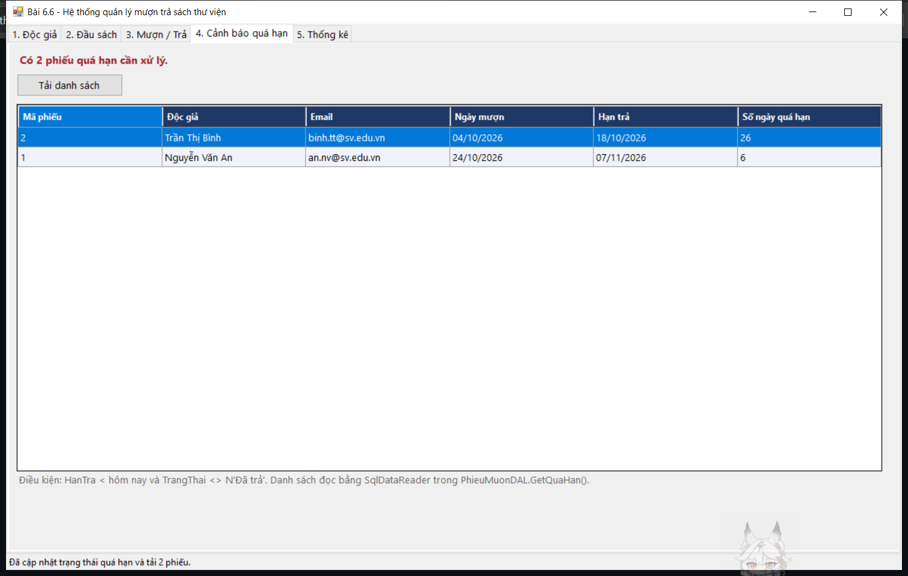
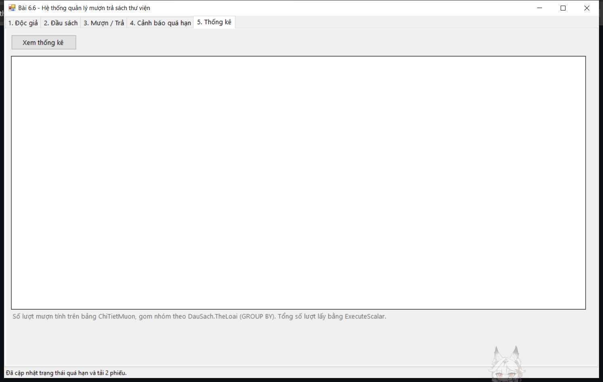

### Sơ đồ dữ liệu

| Bảng | Cột chính |
|------|-----------|
| `DocGia` | `MaDocGia` (PK), `HoTen`, `Email` (UNIQUE), `NgayHetHanThe` |
| `DauSach` | `MaSach` (PK), `TenSach`, `TheLoai`, `SoLuongCon` (CHECK ≥ 0) |
| `PhieuMuon` | `MaPhieu` (PK), `MaDocGia` (FK), `NgayMuon`, `HanTra`, `TrangThai` |
| `ChiTietMuon` | `MaPhieu` + `MaSach` (PK), `SoLuong` (CHECK > 0) |

Quan hệ: một độc giả có nhiều phiếu mượn; một phiếu mượn có nhiều đầu sách
(`ChiTietMuon` xoá theo phiếu — `ON DELETE CASCADE`).

### Quy tắc nghiệp vụ

* Thẻ độc giả **hết hạn thì không được lập phiếu** — BUS kiểm tra trước khi gọi DAL.
* Lập phiếu nằm trong **một transaction**: thêm phiếu → với từng sách khoá dòng
  `WITH (UPDLOCK, HOLDLOCK)` để đọc tồn kho → thiếu hàng thì `throw` → `Rollback`
  toàn bộ (không có phiếu rác, tồn kho không đổi).
* Trả sách: cập nhật trạng thái phiếu **chỉ khi phiếu đang mượn/quá hạn**, sau đó
  cộng lại tồn kho. Trả lần hai bị chặn.
* Quá hạn: `DATEDIFF(DAY, HanTra, GETDATE())`, chỉ tính phiếu chưa trả.

---

## Bài 6.7 — Hệ thống quản lý phòng khám & kê đơn thuốc

###  Chức năng

| Tab | Nội dung |
|-----|----------|
| 1. Tiếp nhận | Tra cứu bệnh nhân theo số điện thoại (Enter để tìm), lưu bệnh nhân mới, tạo hồ sơ khám, xem hồ sơ gần đây, cập nhật chẩn đoán |
| 2. Danh mục thuốc | Thêm/sửa/xoá thuốc, tìm theo tên, nhập thêm hàng vào kho |
| 3. Kê đơn thuốc | Chọn hồ sơ khám, chọn thuốc + số lượng + liều dùng, giỏ đơn tạm, lưu đơn và xuất kho |
| 4. Thanh toán | Lọc đơn theo trạng thái, xem chi tiết, tính tiền khám + tiền thuốc, in hoá đơn |

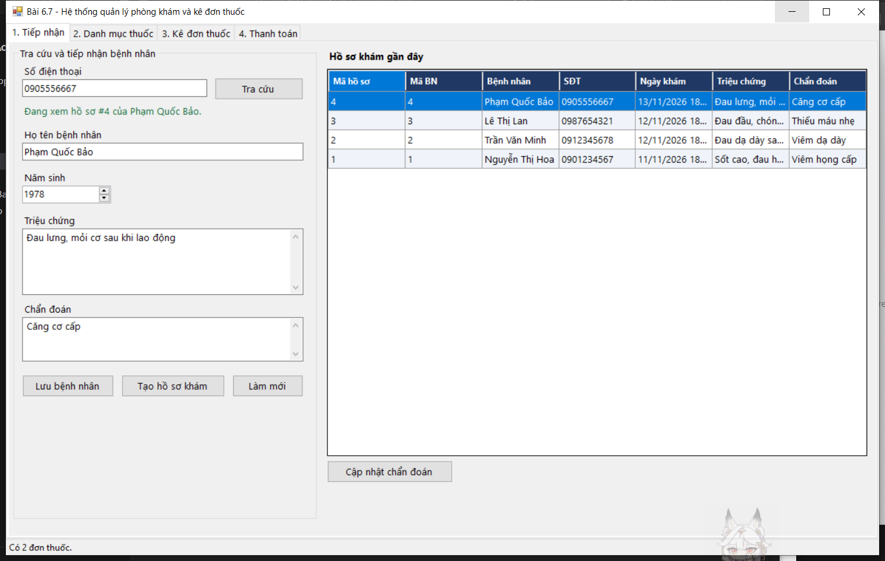
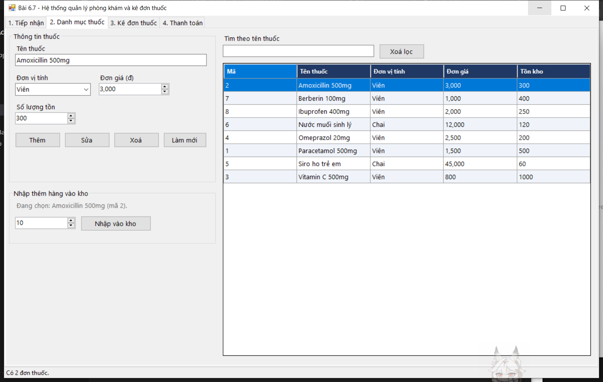
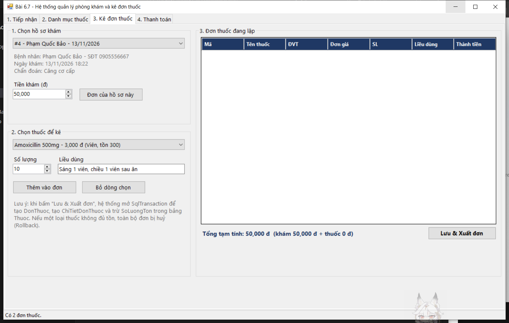
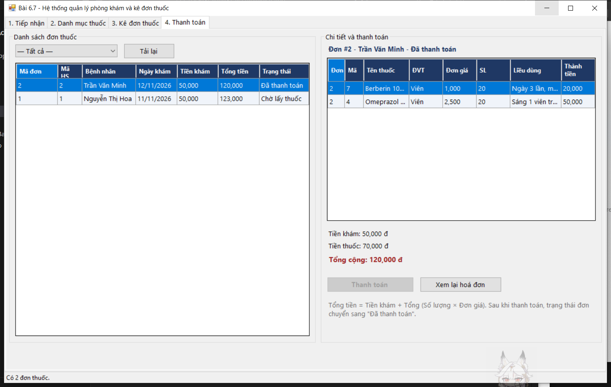

### Sơ đồ dữ liệu

| Bảng | Cột chính |
|------|-----------|
| `BenhNhan` | `MaBN` (PK), `HoTen`, `SoDienThoai` (UNIQUE), `NamSinh` |
| `HoSoKham` | `MaHoSo` (PK), `MaBN` (FK), `NgayKham`, `TrieuChung`, `ChanDoan` |
| `Thuoc` | `MaThuoc` (PK), `TenThuoc`, `DonViTinh`, `DonGia`, `SoLuongTon` |
| `DonThuoc` | `MaDon` (PK), `MaHoSo` (FK), `TienKham`, `TongTien`, `TrangThai` |
| `ChiTietDonThuoc` | `MaDon` + `MaThuoc` (PK), `SoLuong`, `LieuDung` |

Trạng thái đơn thuốc chỉ có hai giá trị: `Chờ lấy thuốc` → `Đã thanh toán`.

### Quy tắc nghiệp vụ

* Số điện thoại 10–11 chữ số, **không trùng** giữa các bệnh nhân; năm sinh 1900 → năm hiện tại.
* Mỗi lần khám tạo một **hồ sơ khám**; đơn thuốc gắn với hồ sơ, không gắn trực tiếp bệnh nhân.
* Lưu đơn trong **một transaction**: thêm `DonThuoc` → từng thuốc khoá dòng đọc tồn
  kho → thiếu thuốc thì `Rollback` (không có đơn rác, tồn kho không đổi) → trừ kho.
* `TongTien = TienKham + SUM(SoLuong × DonGia)` — tính lại khi thanh toán để phản ánh
  đúng giá tại thời điểm trả tiền.
* Thanh toán chỉ thực hiện được khi đơn đang `Chờ lấy thuốc`; thanh toán lần hai bị chặn.

---

##Bài 6.8 — Hệ thống quản lý bàn bida & dịch vụ giải trí

### Chức năng

| Tab | Nội dung |
|-----|----------|
| 1. Sơ đồ bàn | Xem trạng thái 10 bàn (trống / đang chơi), mở bàn, xem hoá đơn đang chạy của bàn |
| 2. Gọi dịch vụ | Thêm / tăng / giảm / bỏ dịch vụ trong hoá đơn đang chơi, lưu dịch vụ vào hoá đơn |
| 3. Thanh toán | Xem trước tiền giờ + tiền dịch vụ, đóng bàn và in hoá đơn |
| 4. Quản lý bàn & menu | Thêm/sửa/xoá bàn (tên, loại, giá giờ), thêm/sửa/xoá dịch vụ (giá, tồn kho, có trừ kho hay không) |
| 5. Lịch sử & doanh thu | Lọc hoá đơn theo ngày, xem chi tiết, tổng doanh thu (giờ chơi + dịch vụ) |

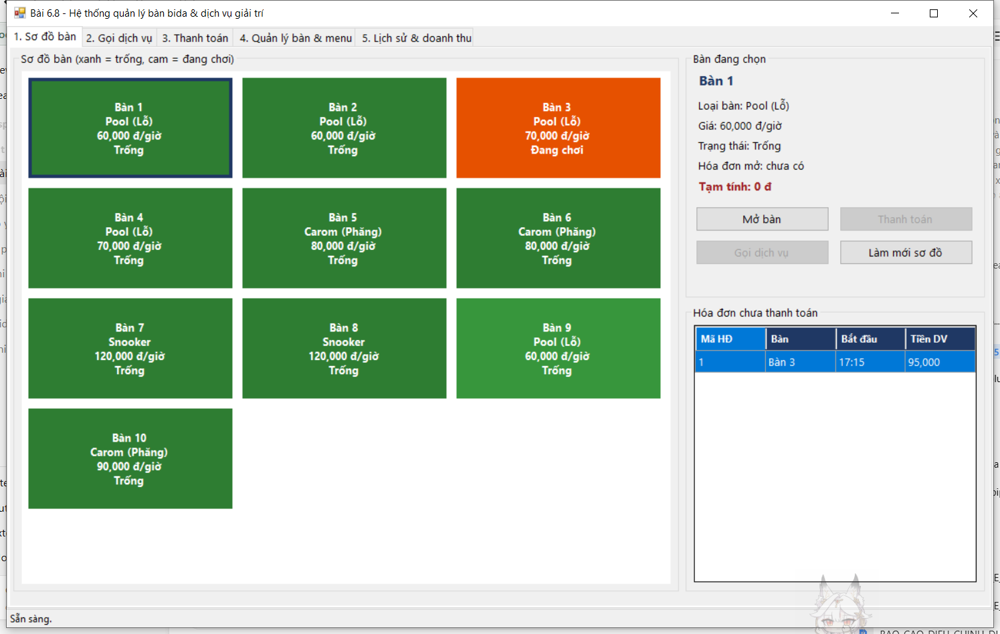
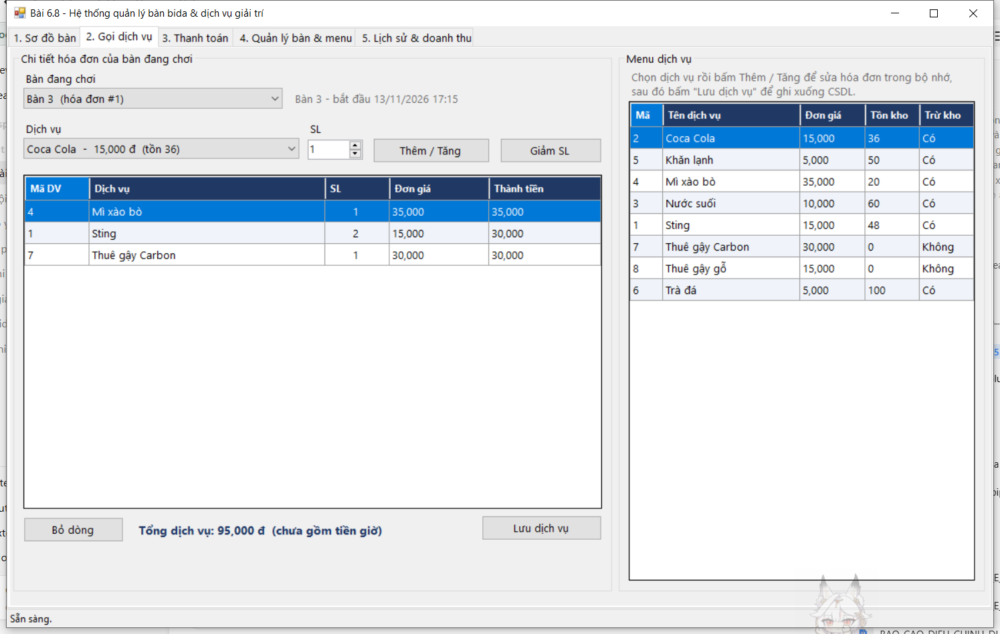
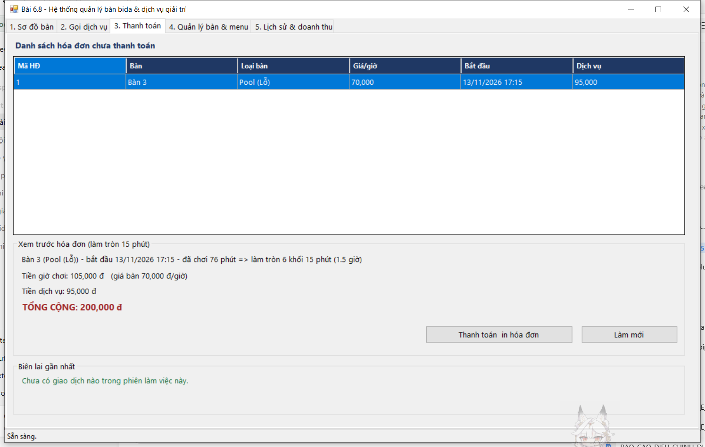
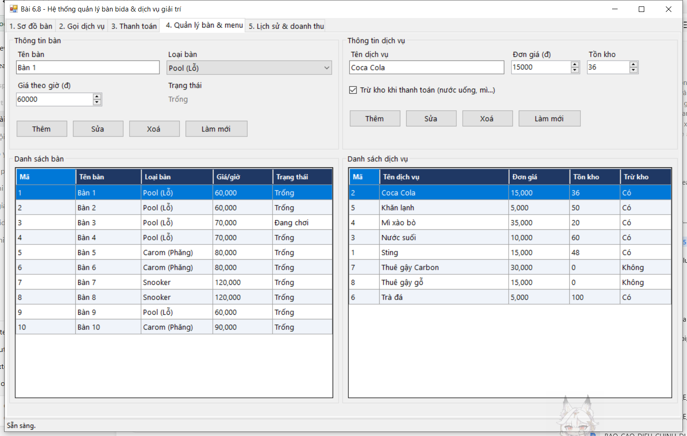
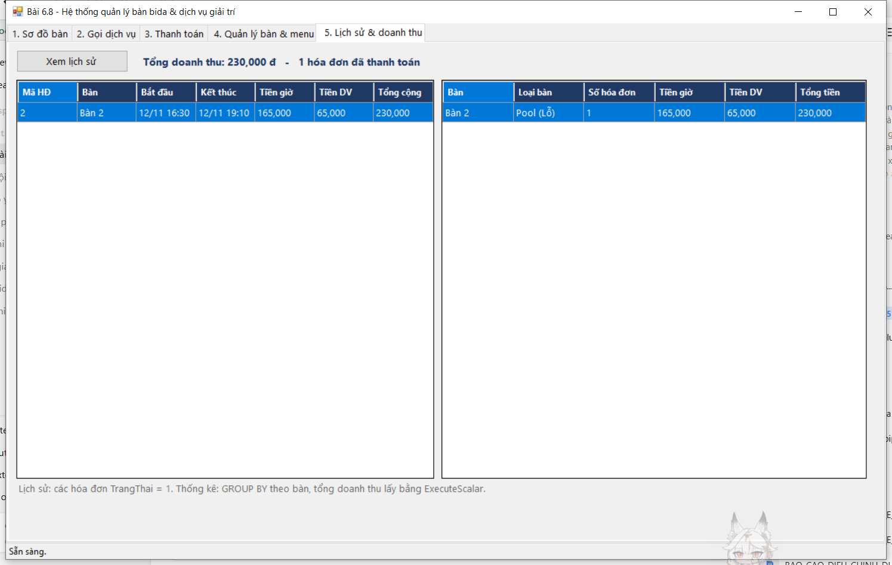

### Sơ đồ dữ liệu

| Bảng | Cột chính |
|------|-----------|
| `BanBida` | `MaBan` (PK), `TenBan`, `LoaiBan`, `GiaTheoGio`, `TrangThai` |
| `MenuDichVu` | `MaDV` (PK), `TenDV`, `DonGia`, `TonKho`, `TruKho` |
| `HoaDon` | `MaHD` (PK), `MaBan` (FK), `GioBatDau`, `GioKetThuc`, `TienGioChoi`, `TienDichVu`, `TrangThai` |
| `ChiTietHoaDon` | `MaHD` + `MaDV` (PK), `SoLuong`, `DonGia` |

### Quy tắc nghiệp vụ

* **Tính tiền giờ theo khối 15 phút, làm tròn lên**:
  `số khối = ceil(số phút / 15)`, tiền = giá/giờ × số khối × 15/60.
* `TruKho = 1`: dịch vụ trừ tồn kho khi gọi; `TruKho = 0`: dịch vụ cho thuê
  (gậy, khăn) không quản lý tồn.
* Mỗi bàn chỉ có **một hoá đơn đang mở** (`GioKetThuc IS NULL`); mở bàn lần hai bị chặn.
* Gọi dịch vụ và thanh toán đều chạy trong transaction; thanh toán đóng bàn
  (`TrangThai = 1`, ghi `GioKetThuc`) và đổi bàn về `Trống`.

